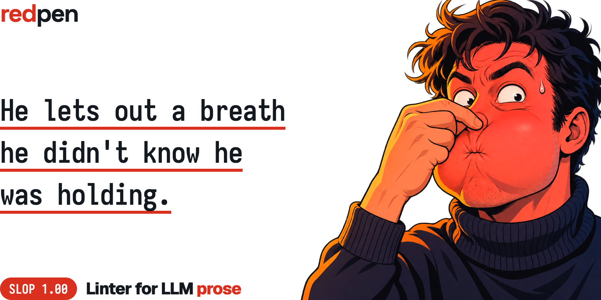

<picture>
  <source media="(prefers-color-scheme: dark)" srcset="assets/banner-dark.png">
  
</picture>

# Redpen for SillyTavern

Redpen reads every reply your model writes and cuts the slop out of it before you see it. *Her breath hitches.* is gone. *He sets the cup down, jaw tight.* becomes *He sets the cup down.*

It only cuts. It never rewrites a word, never calls an LLM, and never touches your own messages.

The model behind it is [Redpen Slop 11M](https://huggingface.co/dempfi/redpen-slop-11m), an 11M-parameter token classifier. It runs in your browser, so nothing you write leaves your machine.

## Install

1. In SillyTavern, open **Extensions** and choose **Install extension**.
2. Paste `https://github.com/dempfi/redpen` and install.
3. Open **Extensions → Redpen** to change the settings.

The model (44 MB) downloads once, on the first reply after install, and is cached by the browser.

## What it cuts

Redpen makes two kinds of cut, and only when the model is confident:

| Cut | Before | After |
| --- | --- | --- |
| A sentence that is all slop | He takes the chair by the window. Her breath hitches. He opens the book. | He takes the chair by the window. He opens the book. |
| A slop tail after a comma or “and” | She crosses the room and stays there, chest heaving. | She crosses the room. |

Everything else stays as the model wrote it. A flagged phrase in the middle of a sentence is left alone, because removing it would mean rewriting the sentence.

## Settings

The defaults are deliberately conservative. At the default confidence, 97% of what the model flags is slop.

| Setting | Default | What it does |
| --- | --- | --- |
| Cut slop from model replies | On | The master switch. |
| Confidence needed to cut | 0.99 | How sure the model must be. Lower it to cut more. |
| Remove a sentence when all of it is slop | On | The first kind of cut. |
| Trim a slop tail after a comma or “and” | On | The second kind of cut. |
| Never touch dialogue | On | Leaves anything inside quotation marks alone. |
| Most of a reply it may remove | 30% | A cap per reply. Redpen never empties a message. |
| Keep the original text with the message | On | Stores the uncut reply so **Restore the last cut message** can bring it back. |
| Show what was cut | On | A small notice listing each cut. |

Greetings and your own messages are never changed.

## Limits

- English only.
- Trained on fiction and roleplay prose.
- It trims; it does not improve. A reply that is slop from end to end mostly stays, because Redpen will not remove more than the cap.

## Development

```sh
npm install
npm test
```

The tests cover the cutting rules and check the in-browser scoring against the PyTorch checkpoint.

## License

The extension is AGPL-3.0, like SillyTavern. The model weights are CC BY-NC 4.0.
